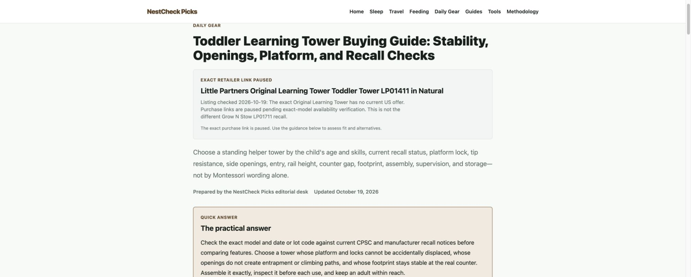
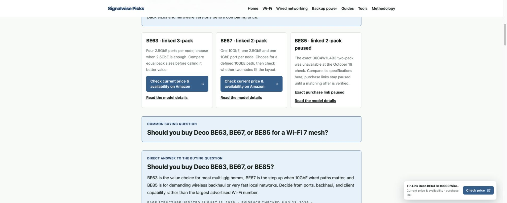

**10月19日商品与转化修复已上线，正式网址验收通过。**

部署版本为 `5de949a2646289d696cbf83af465b3ba744d4b65`。本轮完成两个精确缺货报价停用、指南商品点击标识修复、原210组漏检处理，以及12个已有页面的商品与购买依据更新。另有5个引用 BE85 的 Network 页面随共享报价屏蔽而移除购买按钮。没有新增页面或子域名。

本轮目标是减少无效商家访问，让已有搜索和 AI 访问更容易选择正确商品，并使真实点击能被内部统计接收。搜索增长和订单增长仍需真实流量验证，不能用上线成功代替效果证明。

**商品核对与实际修改**

当天以 Amazon 美国10001配送地区、不带联盟标签的商品页核对16个不同 ASIN，记录见 [merchant-verification.json](merchant-verification.json)。未加购物车、下单或制造线上联盟点击；检查后恢复原配送地区。16个核对对象包含现有流量相关商品和比较证据，不等于全目录逐一核实库存。

| 原页面／商品 | 本轮处理 |
|---|---|
| Baby 学习塔指南：Original Learning Tower LP01411 Natural，B001ECHXVC | 美国报价缺货且无补货日期，停用首屏、正文等所有精确购买入口，保留原指南、安全检查与搜索意图。明确它与另一型号 Grow 'N Stow LP01711 的召回不同，未随意换成相似名称商品。 |
| Network BE85 评测：B0C4W1L4B3 两件套 | 精确两件套缺货，停用共享报价及所有引用入口，保留产品分析与规格依据。 |
| Network BE63、BE67 评测和现有三型号选购指南 | 核对 BE63 B0CN8QLS4K 三件套、BE67 B0FQYQRZQX 两件套；指南加入型号、端口和套装选择卡，BE85 显示暂停购买。先保留快速答案，再呈现购买选择，提醒价格比较必须考虑相同节点数。BE67 三件套仅作核对证据，没有新增报价或页面。 |
| Homeoffice TS4 评测：B09GK8LBWS | 保留仍有货的 TS4，补充何时应考虑 TS5／TS5 Plus 的现行代际选择，不把旧型号页面暗中换成另一商品。 |
| Homeoffice Link 2 评测、MX Brio vs Link 2 比较页：B0DDTH3HX8 | 保留精确 Link 2，补充 Link 2 Pro／2C Pro 的传感器与追踪选择背景，区分实际购买型号。 |
| Baby Omni Breeze 评测：B0931ZY7DK，Onyx Black | 核对低库存的精确变体，补充 Omni Deluxe 为另一代产品的选择背景，保留背带用途、适龄和佩戴安全意图。 |
| Baby 门把手保护罩指南：B0DK1KZ9RQ | 明确核对的是单件装，补充尺寸、成人开门、紧急退出及安装检查。 |
| Network 穿透式网线钳指南：B076MGPQZQ | 明确 Klein VDV226-110 工具本体与连接头、测试仪套装的区别，避免错把配件数量当作同一购买配置。 |
| Homeoffice 吸音板指南：B0G92CQ7KH | 核对 TONOR Walnut 四件装，每件47.2×23.6英寸；展开普通价格报价后确认有货、常规购买按钮、Amazon配送与 TonorDirect US 卖家。说明普通报价选择、面积与成本；没有虚构吸音系数、防火认证或隔音能力。 |

Aqara U400、FP300、Mighty2 等现行型号已有覆盖。当前证据不支持全面替换成新品或另起子域名；应继续保护有入口的精确用途，并按库存、适配、价格和实际选择依据更新。

**点击计量和210组漏检**

指南、点击 API 与检查脚本现在共用已发布运行时目录，精确识别 `family-品类-ASIN`。API 只接受同站点、正确商家、未屏蔽的真实商品身份，拒绝草稿、错误后缀和错误站点。保留真实事件的 eventId 幂等写入。

原目录为505条可用 Amazon 报价、504个去重后的站点＋ASIN组，旧检查器只覆盖294组，漏210组。新增两项报价屏蔽后，现为503条可用报价、502组：**原漏检的209组已覆盖，另1组学习塔按缺货主动屏蔽**。502组全部通过链接结构与联盟标签检查。这个结果不代表502组都已核实实时库存。

回归覆盖530个已发布商品身份、其中355个品类商品，测试正确身份、商家限制、屏蔽、异常输入、QA零写入和事件去重。生产 QA 接口分别验证网线钳、保护罩、吸音板返回200且 `validated:true,persisted:false`；学习塔和 BE85 返回400。没有向生产数据库写入伪点击。真实用户事件后续是否持续入库，仍应随自然流量核对；本次已验证修复后的生产身份验证路径及本地真实持久化分支。

**上线与线上验收**

- 在开发机完成 SEO、ESLint、TypeScript、生产构建与 Linux runtime 打包。制品60,940,575字节，SHA256见 [artifact.json](artifact.json)。
- 用户明确允许本次短暂停 Main 和 Test。14:32:03开始受控切换，14:32:16完成 Affiliate 源站验收，14:32:18恢复 Main、Test，约15秒维护窗口。独立恢复定时器与失败回滚保留至恢复确认；实际可用内存830.1875MiB，通过原704MiB门槛，未降低安全门槛或启动第二个生产候选进程。
- Affiliate 当前实际 systemd WorkingDirectory 为 `/srv/madabase-affiliate/releases/commerce-20261019-5de949a2646289d696cbf83af465b3ba744d4b65`，旧版本留作回滚。Main、Test 原工作目录保留，均 active/running；最终检查三项服务 NRestarts 均为0，Affiliate 自切换起 error 级日志0条。
- 保留34个旧版本哈希静态资源，源站抽验旧资源可用。42个目标页面、308个既有含本地化重定向、7份 sitemap 源站验收0错误；Costume 数据库商品页及其76个已有商品 sitemap URL 专门在生产数据库环境通过。
- 本地292个路由对照中290个通过，两个数据库依赖项在源站通过。12个主要改动页面逐一以390×844检查，均无横向溢出、无被屏蔽商品的购买链接。
- 正式公网共296个网址全部通过，包括181个 Bing／AI 有入口页面、31个历史整改目标、其既有别名与七站发现文件。原有 title、H1、canonical、noindex、HTTP状态和跳转目标保持；robots 内容及 sitemap／llms URL 集合保持。新增检查的4个依赖页面也为200、自指canonical、无被屏蔽购买链接。
- 17个变更页面正式 HTML 均200、重复请求 HIT，JSON-LD 可解析且在 sitemap 中；16个现有图片端点以普通 GET 验证均为有效图片200响应，点击 API 和 RSC 仍为 DYNAMIC。图片优化端点的 HEAD 探测曾返回400，普通浏览器 GET 正常，已分别保存方法与结果。见 [public-after.json](public-after.json)、[changed-page-details.json](changed-page-details.json) 与 [production-click-qa.json](production-click-qa.json)。这些是技术保护验收，不是对 Bing／AI 未来排名或引用量的保证。
- Cloudflare 单 URL 清理后，部分无参数正式网址仍返回旧 HTML，而带 QA 参数的正文已更新。随后只对相同20个完整路径（17页面＋3份 sitemap）进行 Prefix 清理，清除该路径的缓存变体，后台明确返回成功。未整站清缓存，未改 TTL、缓存规则、防火墙或 AI 抓取设置。最终以**无参数正式网址**确认缺货按钮移除与新正文生效。此类限制见 Cloudflare [single-file exclusions](https://developers.cloudflare.com/cache/how-to/purge-cache/purge-by-single-file/) 和 [prefix purge](https://developers.cloudflare.com/cache/how-to/purge-cache/purge_by_prefix/)。
- 公网通过后，精确提交17个实际变更 canonical 至 IndexNow：Network10、Homeoffice4、Baby3，全部 HTTP200。未批量重提交其他页面，未点击 Google Request Indexing。

**原20日检查提前执行的结果**

10月6日17页、10月13日14页，合计31个精确页面均重新打开 GSC URL Inspection 查看。30个已收录；Homeoffice `usb-c-dock-vs-monitor-hub-guide` 仍显示“已抓取，尚未编入索引”，但10月19日14:30的实时测试显示可供 Google 访问、抓取成功且允许索引。保留其已有 Bing／AI 入口与原URL，不因 Google 单项状态而合并或更换意图。

| 批次 | 已收录 | 最新完整7天展示 | 前7天展示 | 最新完整7天点击 | 28天展示／点击 |
|---|---:|---:|---:|---:|---:|
| 10月6日17页 | 17 | 0 | 11 | 0 | 148／3 |
| 10月13日14页 | 13 | 12 | 10 | 0 | 291／6 |

7天数据窗口为10月10–16日，对比10月3–9日；28天为9月19日–10月16日。已有历史点击大多早于本轮上线，不能归因于整改。最新24小时全域卡片仅10次展示、0点击，样本过小。

提前完成的是**整批索引、抓取与最新可用数据检查**。截至当时完整数据只到16日，不能把它称为13日修改后的完整一周效果检查，也不能宣称19日修改已经带来增长。逐页动作与 Bing／AI 保护证据见 [early-cohort-review.csv](early-cohort-review.csv)；31份 GSC 原始观察与实时测试见 [early-gsc-evidence.json](early-gsc-evidence.json)。保留完整数据到齐后的效果判断，以及既有10月27日、11月5日、11月12日检查节点；本次没有创建新定时任务。

正式网页证据：

完整七站搜索、Bing／AI、Clarity与 Amazon 收益基线另见 [10月19日上线前综合审计](../acquisition-commerce-audit-2026-10-19/README.md)。该文保存上线前观察；其中“待实施”“仍有旧按钮”的描述已由本报告的上线结果取代。
