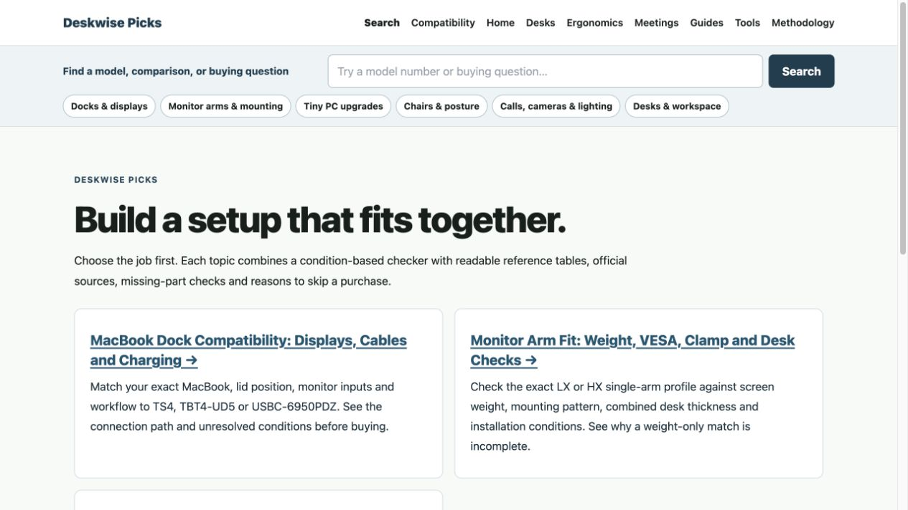

补全版已于 **2026年10月19日19:29:31（中国时间）上线**，正式源码为 `a837332f6b0881c2fc10f4f335715dd6b97954fc`。Main 与 Affiliate 使用 `discovery-20261019-a837332…`；Test 已恢复原版本，三个服务均 active/running、重启0次。用户明确授权了本次 Main/Test 短暂停机和回滚准备。切换至源站验收完成共6.70秒，详见 [发布记录](deployment.json) 和 [最终源站状态](origin-final.log)。

本次是用户指出遗漏后完成的全部首批范围，[范围对照](scope-audit.md) 逐项记录了上一版缺口和补全结果。共9个新 canonical、9个增强的既有指南；补全没有再增加索引页，没有开新域名。

- 主站跨专题搜索与七个 Affiliate 搜索，覆盖1,130条已发布内容；支持型号、问题、内容类型、专题/分类和翻页。搜索 noindex/follow、private/no-store，不进入 sitemap。
- Homeoffice 六类和 Network 三类任务导航，分类页内筛选、指南逐节目录和下一步，九篇既有指南嵌入相应查询。
- 三品牌扩展坞在相同条件下比较：Mac芯片、原生显示/DisplayLink、开合盖、接口方向、充电、网口、完整连线/缺件和保留旧配置的结论。
- 支架按重量上下限、VESA、具体夹具、桌板、加固板、曲面、接口阻挡与运动空间判断，证据缺失输出未知。
- M720q/M920q/M920x 三篇资料和共用升级模型：两槽RAM数量、不购买结论、NVMe/SATA/PCIe冲突、完整配件、维修手册/FRU取证步骤、三机型比较和完整成本/缺项小计。
- Network 分同交换机、跨路由器、直连NAS、互联网路径；计算实际途经的LAN/WAN/套餐瓶颈、端口预算和完整部件，并说明线速上限不等于实测。

正式验收结果：

| 检查 | 结果与证据 |
|---|---|
| 公网HTTP | **317/317有效通过**。初轮316通过，1个旧Baby页面读取超时；[定点重试](public-http-retry.json) 的状态、canonical、title、H1、noindex全部通过。包括181个Bing/AI保护入口、31个既有治理目标、9个新canonical、搜索/错站边界和Costume数据库商品。见 [原始检查](public-http.json)。 |
| 实际浏览器 | **14项交互通过**：四类工具、型号/数量、不买、未知、路由瓶颈、分类筛选、主站跨专题搜索和Network类型/任务组合筛选。正式站390×844的5个工具/搜索页面无横向溢出。见 [记录](public-browser.json)。 |
| 商家与点击 | 新增整机/RAM/SATA三个精确身份在Amazon可见页面核实；美国配送预览检查后已恢复China。实际渲染href均使用精确ASIN和madaoffice-20。9种正式API点击QA通过、数据库写入0。见 [商品核验](public-merchant-checks.json)、[点击QA](public-click-qa.json)。 |
| 缓存 | 初检发现10项旧HTML，均正常重新验证为新版；随后分30+17条精确清理40个既有HTML和7份sitemap。[清理记录](cache-purge.json)。[清理后49个无参数canonical](public-cache.json) 全部新版、无残留旧内容；48个Affiliate重复请求HIT，Main为DYNAMIC。八站搜索private/no-store，API为DYNAMIC，[真实RSC请求](public-rsc.json)八站均DYNAMIC/BYPASS。 |
| 静态资源 | Main与七个子站的新旧JS/CSS **32/32通过**，新资源SHA256与发布包一致；旧哈希资源已保留。见 [检查](public-assets.json)。 |
| 构建和决策 | Main/Affiliate Node20、Next15.5.23生产包和Lint/SEO通过；41项规则/完整性、7项整机身份、20组搜索和独立20个用户决策通过。组件身份/到期/跨站拒绝、成本缺项及来源检查通过；链接格式505/505。这不代表505项旧商品已逐一核实实时供货。 |
| 发现通知 | 精确18个内容canonical的[IndexNow提交](indexnow-submit.log)收到HTTP200：Network5、Homeoffice13；没有扩大为全站提交。Google接受两份相关sitemap重新提交，Bing状态单独记录；通知成功不代表已收录或排名提升。 |

Amazon整机是M720q `B0B14FTVTV`（i5-8500T/16GB/256GB NVMe/Renewed）；升级件是Kingston `KCP426SD8/16` 单条16GB `B07D2DZ42B`、Crucial MX500 `CT1000MX500SSD1` 1TB SATA `B078211KBB`。组件按钮只在对应路线、数量与条件明确时显示；整机单列为替代方案，不充当升级套件。七天核验期结束自动关闭入口，不自动换货。eBay可选，本批没有启用未核实的eBay或NVMe报价。

来源和竞品边界：

| 参照 | 对方已有能力 | 本轮补充的可验收价值 | 尚不能宣称的部分 |
|---|---|---|---|
| [Plugable Dock Finder / Guarantee](https://plugable.com/pages/compatibility-guarantee) | 三步选型、厂商兼容支持与测试承诺 | 跨所选品牌的 Mac 芯片/开合盖、原生与 DisplayLink、接口方向、软件许可、充电与网口限制一起解释 | 无厂商级全量设备覆盖、实机保证或售后承诺 |
| [Ergotron Mount Finder](https://www.ergotron.com/tools/mount-finder) | 按显示器型号查询 VESA、重量、深度与支架 | 把夹具具体版本、加固板厚度、桌板批准、最低承重、曲面扭矩和未知情况纳入结果 | 不认证桌板结构或替代厂商安装确认；型号库仍很小 |
| [ServeTheHome M720q](https://www.servethehome.com/lenovo-thinkcentre-m720q-tinyminimicro-feature/) | 实机拆解、内图、配置和扩展件经验 | 三型号横向差异、按升级任务判断冲突、完整缺件清单、原厂证据与商家配置分开 | 尚无自己的拆机、功耗、噪声、温度、驱动或长期稳定性数据，也没有已核实的全部 FRU 套件 |

这些是可验收的增量价值；没有自己的实机、拆机、功耗、噪声或长期稳定性数据，不能宣称已全面胜过竞品。未知的逐机FRU继续保持未知，不猜测万能托架/线缆/riser。页面展示官方依据和边界，不生成没有实测依据的Review结构数据。

数据库继续使用现有PostgreSQL/Prisma点击体系；资料模型来自版本化结构文件。没有数据库迁移或新增在线数据库依赖。

恢复准备：原Main `seo-20260925-8055b15`、原Affiliate `commerce-20261019-5de949a…`和原unit配置保留。预测768MiB与启动前实测704MiB门槛保持；实测Main812.15MiB、Affiliate754.24MiB均通过。激活控制器135秒上限、10秒停止超时，独立150秒恢复定时器；验收成功后定时器已停止。8种失败场景预演通过，本次没有触发回滚。精确恢复命令和状态路径见deployment.json。

本批逐页观察日期为 **10月26日、11月2日、11月18日**，覆盖18个新/增强canonical及发现、商家、转化路径。既有10月27日、11月5日、11月12日批次检查不变。无新增自动任务、外部分发或批量Google Request Indexing。搜索效果留待观察，不由代码验收推断。

正式站预览：

