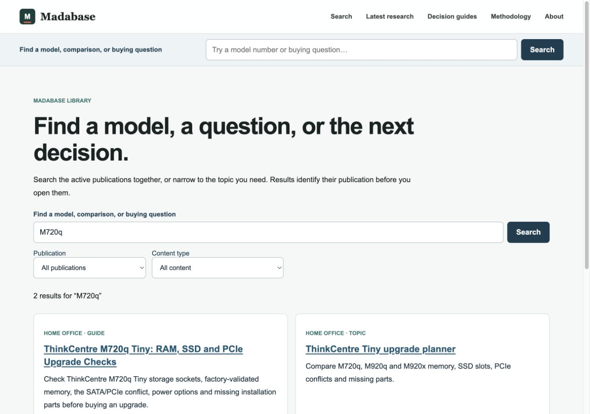
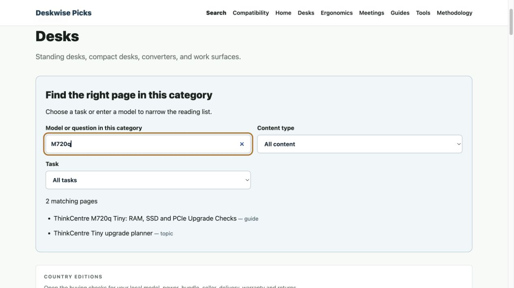

原约定已逐项复核并补全本地实现，**尚未上线，未暂停任何正式服务**。上一版只有首批工具可运行，不能代表全部约定完成；完整差异见 [范围对照](scope-audit.md)。

本次补齐：Homeoffice/Network 任务导航、分类页内筛选、指南逐节目录与下一步、三款扩展坞同条件比较和缺线清单、支架接口/行程检查、Tiny 两槽内存数量与不买结论、完整配件/成本表及三型号比较、按真实路由路径计算 Network 瓶颈。新增零索引页，仍只有原批次9个新 canonical。

商家选项增加准确料号的内存 B07D2DZ42B 与 SATA SSD B078211KBB；只在对应路线通过、所需数量可确定时显示。整机继续作为独立替代，不能代替升级件。未核实的 FRU 或 NVMe 报价保持未知，不生成购买按钮。已加入独立 [20个用户决策验收](user-decisions.json)，不再把搜索排名测试当作决策工具验收。

补全版本验证：Affiliate 生产构建与打包、Lint、SEO、原41项规则/完整性加7项整机报价检查、20组搜索、独立20个用户决策、成本/来源/两项组件身份与到期检查通过。链接格式505/505（不是505项实时供货核验）；3个新商品身份的9种本地点击QA通过，数据库写入为零。317个HTTP目标无回归失败，316通过、1个数据库依赖的Costume商品仍待配置正式源站核验。浏览器完成四类工具和分类实际交互；390×844复验新增控件所在的13个页面/结果，无页面横向溢出。Main未改动，其上版已验收生产包继续使用；1130条搜索索引一致。

以下为原批次基础记录，若与上面补全范围/最新验证文件冲突，以本段、scope-audit.md、scope-checks.log、scope-http.json、scope-mobile.json和新artifact.json为准。

首版完成搜索、兼容查询、三型号 Tiny 资料与本地生产包验收，**尚未发布到正式网站**。

这是用户明确授权的质量建设批次。保留 Homeoffice → Tiny 小主机 → Network 场景的结构，不增加域名。原冻结策略只为下列 9 个精确 canonical 记录例外；搜索结果页不参与索引，其他新增页面继续遵循证据和批次检查要求。

已完成的结果：

- 主站跨专题搜索与七个 Affiliate 子站搜索；1,130 条已发布内容，支持型号、问题、内容类型、专题/分类和翻页。主站结果标明真正的目的专题，草稿和隔离页面不进入搜索。搜索采用服务端渲染，GET 查询、稳定 `/search` canonical、noindex/follow、private/no-store；不把筛选组合写入 sitemap。
- Homeoffice 三类查询：MacBook 与扩展坞、显示器/支架/桌板、M720q/M920q/M920x 升级。Network 提供 PC/NIC/交换机/NAS 瓶颈与端口预算。修改输入清除旧结果，区分附条件、冲突、证据不足，给出原因、连线/部件检查及来源。
- 新增 Tiny 三型号资料：区分 B360/Q370、I219-V/I219-LM、1/2 个存储 M.2、工厂 32GB 验证与未知容量、PCIe/SATA 空间、适配器、缺件与验收。M920x 单独解释第二 NVMe 和 special-bid RAID；M920q 不套用 SFF/Tower 内存布局；M720q 不把 WLAN 或空焊盘当第二 NVMe。
- 已有九个指南加入对应工具，保留原标题、H1、canonical 与原购买问题；主页提供按任务进入资料的入口。参考表和正文在不执行查询 JavaScript 时仍在 HTML 中。
- 一项 Amazon 整机入口：M720q，ASIN B0B14FTVTV，i5-8500T/16GB/256GB NVMe/Renewed，使用 madaoffice-20。美国配送预览已核实商品身份和供货，未访问带归因的购买链接。页面不显示静态价格或库存保证，不把翻新商加装件当原厂规格，不把整机当升级套件。七天人工核验期结束后自动关闭购买入口；不自动替换商品。

商家选择按配置、供货、卖家条件和完整购买成本决定。Amazon 可以直接承接；eBay 是可选渠道，本轮没有勉强启用 eBay 购买按钮。账户核验记录只保存在本地，不随网站源码发布。

与竞品比较采用可验证的标准，不声明已经全面胜过它们：

| 参照 | 对方已有能力 | 本轮补充的可验收价值 | 尚不能宣称的部分 |
|---|---|---|---|
| [Plugable Dock Finder / Guarantee](https://plugable.com/pages/compatibility-guarantee) | 三步选型、厂商兼容支持与测试承诺 | 跨所选品牌的 Mac 芯片/开合盖、原生与 DisplayLink、接口方向、软件许可、充电与网口限制一起解释 | 无厂商级全量设备覆盖、实机保证或售后承诺 |
| [Ergotron Mount Finder](https://www.ergotron.com/tools/mount-finder) | 按显示器型号查询 VESA、重量、深度与支架 | 把夹具具体版本、加固板厚度、桌板批准、最低承重、曲面扭矩和未知情况纳入结果 | 不认证桌板结构或替代厂商安装确认；型号库仍很小 |
| [ServeTheHome M720q](https://www.servethehome.com/lenovo-thinkcentre-m720q-tinyminimicro-feature/) | 实机拆解、内图、配置和扩展件经验 | 三型号横向差异、按升级任务判断冲突、完整缺件清单、原厂证据与商家配置分开 | 尚无自己的拆机、功耗、噪声、温度、驱动或长期稳定性数据，也没有已核实的全部 FRU 套件 |

这些是我们选择的增量方向，不是对竞品所有页面的穷尽审计。不能用文章更长、工具更多或技术通过代替搜索效果。GSC 是观察入口；内容质量、抓取和相关性改进不能保证 Google 优先展示。

本地验收：

- Main 与 Affiliate 的 Node 20.20.0 / Next 15.5.23 生产构建、standalone 打包完成。Linux x64 图片库版本经打包器核对；环境文件从 runtime 排除。
- 41 项规则/目录完整性检查、7 项精确商品/标签/到期检查、20 组真实型号/问题搜索全部通过，预期结果均在前三。
- 317 个 HTTP 目标：316 个通过，1 个 Costume 数据库商品页在隔离本地环境没有数据，明确留待正式源站验收。296 个旧网址对照覆盖 181 个 Bing/AI 保护入口及 31 个既有治理目标；比对 status、Location、canonical、title、H1、noindex。九个新 canonical、九个搜索检查及三个错误站点边界也通过；新 canonical 在 sitemap，搜索不在 sitemap。
- 新 ASIN 的真实点击验证器在 QA 模式返回 validated:true / persisted:false，错误站点与 eBay 商家返回400，没有测试点击写入数据库。
- 390×844 下九个新页面、七站主页与 Main 搜索共17页均无页面横向溢出；四类查询表单的成功、冲突及修改后清除旧结果已实际操作。另验收桌面搜索显示。
- 当前链接格式检查 503/503；其中502条旧报价并未在本轮重新逐个核实实时供货。新整机供货核验单独记录，不能用格式检查代替库存。

数据库边界：现有 Affiliate 点击仍使用原 PostgreSQL/Prisma 幂等写入。查询资料采用结构化版本文件与逐字段官方来源，搜索来自最终发布目录；不为当前的小型资料库新增一次在线数据库依赖。没有迁移、删除或覆盖服务器数据库。未来需要多人维护、频繁库存刷新或大规模型号关系时，再把同一数据模型迁入数据库。

发布包和待执行的切换/回滚记录位于本目录。正式服务仍是之前的 commerce-20261019 与 Main seo-20260925；本地验证不是上线。当前服务器只读容量检查显示不能启动并行候选，需保留原768MiB预测/704MiB实测门槛，为两站切换准备独立恢复机制。任何额外暂停 Test 都必须限定在本次明确授权的维护窗口。

上线后再记录准确的 Day 7/14/30 日期，逐一复核本批18个内容 canonical（9新+9旧）、3个主页发现入口、商家身份和点击路径；既有10月27日、11月5日、11月12日检查保持。无新增自动任务，无外部分发，无批量 Google Request Indexing。

首版搜索预览：

补全后的分类筛选预览：

