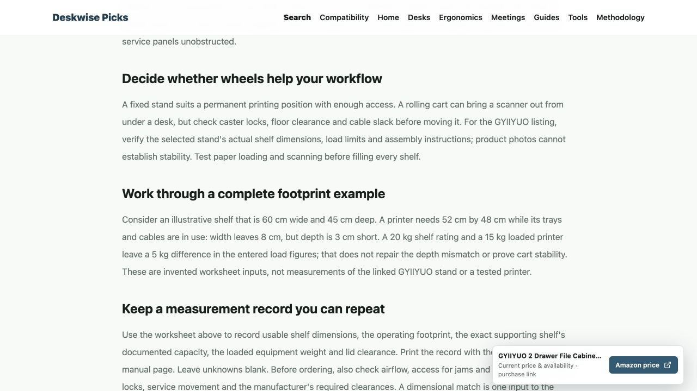

2026 年 10 月 25 日已通过 Git 发布已验收部分，源代码版本为 `27a538d7a40e83c062e4d6ac2d74e63786187fe9`。源站于北京时间 19:07 完成切换，主站、Affiliate 和 Test 后续检查均为运行正常、HTTP 200、自动重启次数 0。Test 已恢复原目录。

本次包含 499 个不同的已审核内容页面，以及根据实际线上 77 条商品记录验证的目录与购物入口修复。缺货、身份冲突和隐形眼镜限制仍保留。新增数据库结构已按用户明确授权完成，没有删除或改写现有业务记录。

- 公网 594/594 个不同地址通过：499 个内容页面、77 个商品页面、7 个首页、8 份站点地图和主站 3 个页面。
- 首轮 21 项旧缓存响应在精确复查后全部更新。保留初次结果；没有全站清缓存或改缓存规则。
- 新旧静态资源公网 8/8 通过。电脑端打印机支架页面阅读正文时显示悬浮 Amazon 按钮，测量表单操作期间收起，未发现横向溢出。
- 可购买款首屏有对应选项入口；Hufflepuff/Ravenclaw 身份冲突页面没有购买按钮。未跟随商家购物链接或制造购物点击。
- 新版本 QA 事件验证成功且不入库，旧版本事件被拒绝。只读查询发现 1 条该版本已接受的非 QA 内容浏览记录；这不证明真实人类访问、购物或成交。
- Google Search Console 的 8 份站点地图均收到提交成功回执；IndexNow 的 583 个变更网址均收到 HTTP 200。通知成功不等于已重新抓取、收录或排名改善。

整体整改仍为 60/111 批通过本地验收，约 54%。这次发布不会把未完成批次记为完成。剩余来源核验、逐商品核验、正文批次、部分对比表购买入口与地区模板问题继续按原台账处理。

完整机器记录见 `completed-release-receipt.json`，不同公网地址的最终结果见 `completed-public-final-acceptance.json`。初次验收及复查分别保存在 `completed-public-checks.json` 和 `completed-public-retry-checks.json`。

